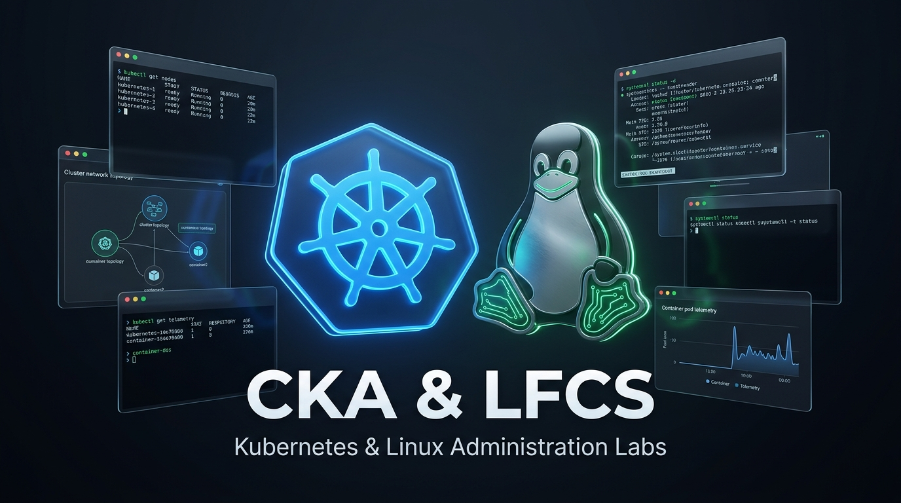

<p align="center">
  
</p>

# ☸ CKA, 🚀 CKAD & 🐧 LFCS Hands-on Practice Labs, Mock Exams & Study Suite

A comprehensive, calendar-aligned preparation suite for the **Certified Kubernetes Administrator (CKA)**, **Certified Kubernetes Application Developer (CKAD)**, and **Linux Foundation Certified System Administrator (LFCS)** certifications.

> [!IMPORTANT]
> **Kubernetes Cluster Infrastructure Acknowledgement:**
> The Kubernetes multi-node cluster formation and Vagrant provisioning in this repository are based on and adapted from <a href="https://github.com/kodekloudhub/certified-kubernetes-administrator-course/tree/master/kubeadm-clusters/virtualbox" target="_blank" rel="noopener noreferrer">KodeKloud's Certified Kubernetes Administrator Course (kubeadm-clusters/virtualbox)</a>. It supports both **CKA** and **CKAD** exam objectives on `controlplane`, `node01`, and `node02`, augmented with a dedicated Ubuntu Linux machine (`LFCS`) to support comprehensive LFCS administration objectives.

Designed with **complete track modularity**: Whether you are studying exclusively for the **CKA**, exclusively for the **CKAD**, exclusively for the **LFCS**, or tackling **multiple certifications in tandem**, each exam track provides a completely autonomous, standalone ecosystem — including its own web dashboard, exam simulator, lab generator, study guide builder, terminal progress tracker, and Pomodoro browser extension.

---

## 📑 Table of Contents

- [📁 Repository Architecture](#repository-architecture)
- [🎯 Choose Your Track](#choose-your-track)
  - [☸ Option A: Preparing ONLY for CKA](#option-a-cka)
  - [🚀 Option B: Preparing ONLY for CKAD](#option-b-ckad)
  - [🐧 Option C: Preparing ONLY for LFCS](#option-c-lfcs)
  - [🌟 Option D: Multi-Track / Concurrently (CKA, CKAD, LFCS)](#option-d-multi)
- [🖥 Lab Infrastructure (VirtualBox via Vagrant)](#lab-infrastructure)
  - [Prerequisites](#infrastructure-prerequisites)
  - [Virtual Machine Topology](#vm-topology)
  - [Provisioning the Machines](#provisioning-machines)
  - [Initializing Kubernetes Cluster (Calico CNI)](#initializing-k8s)
  - [Tearing Down & Purging VMs](#teardown-vms)
- [🛠 Unified Lab CLI (`./lab`)](#unified-lab-cli)
- [💻 Mock Exams & Exam Simulators](#mock-exams)
  - [Official CKAD Exam Weight Calibration](#ckad-domains)
- [📅 Study Calendar & Schedule Generator](#schedule-sync)
  - [Interactive Customization Prompts & Permutations](#calendar-prompts)
  - [Calendar Outputs & Formats](#calendar-outputs)
- [📜 Credits & Attributions](#credits)
- [📄 License (MIT)](#license)

---

<a id="repository-architecture"></a>
## 📁 Repository Architecture

```text
devops-labs-mockexams-studyguides/
│
├── cka/                            # ☸ STANDALONE CKA TRACK
│   ├── vagrant/                    # Dedicated CKA 3-node K8s cluster Vagrantfile & provisioning
│   ├── lab                         # Dedicated CKA Lab CLI orchestrator (start, check, solve, reset, vm)
│   ├── webapp/                     # Dedicated CKA web dashboard & killer.sh exam simulator (Port 5051)
│   ├── pomodoro-extension/         # Dedicated CKA Pomodoro timer Chrome extension (links to 5051)
│   ├── generate_calendar.py        # Dedicated CKA study calendar generator (prompts start date & duration)
│   ├── generate_labs.py            # Dedicated CKA lab & mock exam generator script
│   ├── generate_guides.py          # Dedicated CKA daily study guide generator script
│   ├── study_todo.py               # Dedicated CKA terminal progress tracker & checklist
│   ├── schedule.template.csv       # Standard CKA curriculum schedule template
│   ├── guides/                     # 48 Track-specific CKA daily study guides & architectural theory
│   ├── kodekloud_cka/              # KodeKloud CKA course notes and references
│   ├── mock-cka-1/                 # Full-scale CKA timed mock exam 1 (17 killer.sh questions)
│   ├── mock-cka-2/                 # Full-scale CKA timed mock exam 2 (17 killer.sh questions)
│   └── w1d1-cka/ ... w8d6-cka/     # 48 Calendar-aligned hands-on Kubernetes lab scenarios
│
├── ckad/                           # 🚀 STANDALONE CKAD TRACK
│   ├── lab                         # Dedicated CKAD Lab CLI orchestrator (start, check, solve, reset, vm)
│   ├── generate_calendar.py        # Dedicated CKAD study calendar generator (prompts start date & duration)
│   ├── generate_guides.py          # Dedicated CKAD daily study guide generator script
│   ├── study_todo.py               # Dedicated CKAD terminal progress tracker & checklist
│   ├── schedule.template.csv       # Standard CKAD curriculum schedule template
│   ├── guides/                     # 48 Track-specific CKAD daily study guides & application developer theory
│   ├── mock-ckad-1/                # Full-scale CKAD timed mock exam 1 (16 killer.sh questions, official weights)
│   ├── mock-ckad-2/                # Full-scale CKAD timed mock exam 2 (16 killer.sh questions, official weights)
│   └── w1d1-ckad/ ... w8d6-ckad/   # 48 Calendar-aligned hands-on CKAD lab scenarios
│
├── lfcs/                           # 🐧 STANDALONE LFCS TRACK
│   ├── vagrant/                    # Dedicated LFCS single-node VM Vagrantfile & provisioning
│   ├── lab                         # Dedicated LFCS Lab CLI orchestrator (start, check, solve, reset, vm)
│   ├── webapp/                     # Dedicated LFCS web dashboard & PSI exam simulator (Port 5052)
│   ├── pomodoro-extension/         # Dedicated LFCS Pomodoro timer Chrome extension (links to 5052)
│   ├── generate_calendar.py        # Dedicated LFCS study calendar generator (prompts start date & duration)
│   ├── generate_labs.py            # Dedicated LFCS lab & mock exam generator script
│   ├── generate_guides.py          # Dedicated LFCS daily study guide generator script
│   ├── study_todo.py               # Dedicated LFCS terminal progress tracker & checklist
│   ├── schedule.template.csv       # Standard LFCS curriculum schedule template
│   ├── guides/                     # 48 Track-specific LFCS daily study guides & system concepts
│   ├── mock-lfcs-1/ ... 4/         # 4 Full-scale LFCS timed mock exams (20 PSI questions each)
│   └── w1d1-lfcs/ ... w8d6-lfcs/   # 48 Calendar-aligned hands-on Linux lab scenarios
│
├── vagrant/                        # 🖥 Infrastructure & VM Provisioning (VirtualBox)
│   │                               # Based on KodeKloud kubeadm-clusters/virtualbox
│   ├── Vagrantfile                 # Multi-node K8s cluster (controlplane, node01, node02) + LFCS VM
│   ├── docs/                       # Compute, prerequisites & connectivity setup guides
│   └── ubuntu/                     # Provisioning scripts (kubeadm, containerd, hosts, ssh keys)
│
├── tools/                          # 🧰 Consolidated Utilities (Unified Multi-Track Mode)
│   ├── webapp/                     # Multi-track unified Flask web dashboard & exam simulator (Port 5050)
│   ├── pomodoro-extension/         # Unified Pomodoro extension
│   ├── curriculum/                 # Syllabus data definitions & question bank (CKA, CKAD, LFCS)
│   ├── generate_calendar.py        # General Study Calendar & Schedule Generator (supports all permutations)
│   ├── generate_daily_guide.py     # Master parallel study guide generator
│   ├── study_todo.py               # Multi-track curses progress tracker
│   └── start_simulator.sh          # Terminal mock exam launcher
│
├── lab                             # 🚀 Master CLI Launcher & Forwarder (dispatches to cka/lab, ckad/lab, or lfcs/lab)
├── LICENSE                         # MIT Open Source License
├── .gitignore                      # Ignores personal/generated schedules (*.ics, *.csv, *.json)
└── README.md
```

---

<a id="choose-your-track"></a>
## 🎯 Choose Your Track

<a id="option-a-cka"></a>
### Option A: Preparing ONLY for CKA (Certified Kubernetes Administrator)

You can work entirely inside the `cka/` folder without touching CKAD or LFCS:

```bash
cd cka

# 1. Provision ONLY the 3-node Kubernetes cluster (controlplane, node01, node02)
./lab vm up                 # Or: cd vagrant && vagrant up

# 2. Dedicated CKA Lab CLI (manage, grade, and solve Kubernetes scenarios)
./lab list                  # List all 48 CKA daily labs and 2 killer.sh mock exams
./lab start w1d1-cka        # Inject scenario into K8s cluster (controlplane, node01, node02)
./lab show w1d1-cka         # View scenario objectives & tasks
./lab check w1d1-cka        # Automatically grade your work
./lab solve w1d1-cka        # Reveal step-by-step solutions
./lab reset w1d1-cka        # Reset scenario to clean state
./lab vm status             # Check cluster VM status
./lab ssh controlplane      # Jump directly into the master node

# 3. Run the terminal progress tracker & daily checklist
python3 study_todo.py

# 4. Customize your study calendar (asks when you start & for how long)
python3 generate_calendar.py

# 5. Launch the dedicated CKA Web Dashboard & Killer.sh Exam Simulator (http://localhost:5051)
bash webapp/start.sh

# 6. Generate or update all 48 CKA daily HTML study guides
python3 generate_guides.py

# 7. Generate or rebuild all 48 CKA labs and killer.sh mock exams
python3 generate_labs.py

# 8. Import cka/schedule.ics into Google Calendar or Thunderbird
```

**Pomodoro Extension for CKA:**
1. Open Google Chrome or Brave and go to `chrome://extensions/`.
2. Turn on **Developer mode** (top right).
3. Click **Load unpacked** and select `cka/pomodoro-extension/`.
4. The extension is pre-configured with CKA focus sessions and direct shortcuts to the study webapp at `http://localhost:5050`.

---

<a id="option-b-ckad"></a>
### Option B: Preparing ONLY for CKAD (Certified Kubernetes Application Developer)

You can work entirely inside the `ckad/` folder targeting the 3-node Kubernetes cluster:

```bash
cd ckad

# 1. Provision or verify the Kubernetes cluster (controlplane, node01, node02)
./lab vm status             # Verify controlplane, node01, node02 are running
./lab vm up                 # Start VMs if halted

# 2. Dedicated CKAD Lab CLI (manage, grade, and solve developer scenarios)
./lab list                  # List all 48 CKAD daily labs and 2 killer.sh mock exams
./lab start w1d1-ckad       # Inject scenario into K8s cluster
./lab show w1d1-ckad        # View scenario objectives & tasks
./lab check w1d1-ckad       # Automatically grade your work
./lab solve w1d1-ckad       # Reveal step-by-step solutions
./lab reset w1d1-ckad       # Reset scenario to clean state
./lab ssh controlplane      # Jump directly into the control plane

# 3. Run the terminal progress tracker & daily checklist
python3 study_todo.py

# 4. Customize your study calendar (prompts start date & duration)
python3 generate_calendar.py

# 5. Generate or update all 48 CKAD daily HTML study guides
python3 generate_guides.py

# 6. Import ckad/schedule.ics into Google Calendar or Thunderbird
```

---

<a id="option-c-lfcs"></a>
### Option C: Preparing ONLY for LFCS (Linux Foundation Certified SysAdmin)

You can work entirely inside the `lfcs/` folder without touching Kubernetes:

```bash
cd lfcs

# 1. Provision ONLY the standalone LFCS practice VM
./lab vm up                 # Or: cd vagrant && vagrant up

# 2. Dedicated LFCS Lab CLI (manage, grade, and solve Linux scenarios)
./lab list                  # List all 48 LFCS daily labs and 4 PSI mock exams
./lab start w1d1-lfcs       # Inject scenario into LFCS target VM
./lab show w1d1-lfcs        # View scenario objectives & tasks
./lab check w1d1-lfcs       # Automatically grade your work
./lab solve w1d1-lfcs       # Reveal step-by-step solutions
./lab reset w1d1-lfcs       # Reset scenario to clean state
./lab vm status             # Check LFCS VM status
./lab ssh                   # Jump directly into LFCS VM

# 3. Run the terminal progress tracker & daily checklist
python3 study_todo.py

# 4. Customize your study calendar (asks when you start & for how long)
python3 generate_calendar.py

# 5. Launch the dedicated LFCS Web Dashboard & PSI Exam Simulator (http://localhost:5052)
bash webapp/start.sh

# 6. Generate or update all 48 LFCS daily HTML study guides
python3 generate_guides.py

# 7. Generate or rebuild all 48 LFCS labs and 4 PSI mock exams
python3 generate_labs.py

# 8. Import lfcs/schedule.ics into Google Calendar or Thunderbird
```

**Pomodoro Extension for LFCS:**
1. Open Google Chrome or Brave and go to `chrome://extensions/`.
2. Turn on **Developer mode** (top right).
3. Click **Load unpacked** and select `lfcs/pomodoro-extension/`.
4. The extension is pre-configured with LFCS focus sessions and direct shortcuts to the study webapp at `http://localhost:5050`.

---

<a id="option-d-multi"></a>
### Option D: Multi-Track / All Certifications Concurrently (CKA, CKAD, LFCS)

Use the root orchestrator `./lab` and unified tooling:

```bash
# List all 152 scenarios across CKA, CKAD, and LFCS
./lab list

# Filter scenarios by track
./lab list cka
./lab list ckad
./lab list lfcs

# Launch the unified webapp dashboard on port 5050
bash tools/start_webapp.sh

# Launch the general Study Calendar & Schedule Generator (supports all 7 permutations)
./lab calendar
```

---

<a id="lab-infrastructure"></a>
## 🖥 Lab Infrastructure (VirtualBox via Vagrant)

The lab environment runs locally on Oracle VirtualBox using automated Vagrant provisioning, adapted from <a href="https://github.com/kodekloudhub/certified-kubernetes-administrator-course/tree/master/kubeadm-clusters/virtualbox" target="_blank" rel="noopener noreferrer">KodeKloud's Certified Kubernetes Administrator Course</a>.

<a id="infrastructure-prerequisites"></a>
### Prerequisites
- **VirtualBox** (>= 6.1 or 7.0):
  - Ubuntu / Debian: `sudo apt install virtualbox`
  - Arch Linux: `sudo pacman -S virtualbox virtualbox-host-modules-arch`
  - Ensure your user is in the `vboxusers` group:
    ```bash
    sudo usermod -aG vboxusers $USER
    ```
- **Vagrant** (>= 2.3):
  > [!IMPORTANT]
  > **Ubuntu 24.04 LTS (Noble) & Debian 12 Notice**: `vagrant` has been removed from the default distribution apt repositories (`Package 'vagrant' has no installation candidate`). Install HashiCorp's official release package:
  > ```bash
  > wget https://releases.hashicorp.com/vagrant/2.4.1/vagrant_2.4.1-1_amd64.deb
  > sudo dpkg -i vagrant_2.4.1-1_amd64.deb && rm vagrant_2.4.1-1_amd64.deb
  > ```
- **Host Compute Resources**: >= 4 vCPUs, >= 8 GB RAM (or >= 4 GB RAM when running CKA-only or LFCS-only).

<a id="vm-topology"></a>
### Virtual Machine Topology

| VM Name | Hostname | Role | OS | CPUs | RAM | Default NAT IP | Forwarded SSH Port |
| :--- | :--- | :--- | :--- | :--- | :--- | :--- | :--- |
| `controlplane` | `controlplane` | K8s Control Plane Master | Ubuntu 22.04 | 2 | 2048 MB | `192.168.56.11` | `2710 -> 22` |
| `node01` | `node01` | K8s Worker Node 1 | Ubuntu 22.04 | 1 | 1024 MB | `192.168.56.21` | `2721 -> 22` |
| `node02` | `node02` | K8s Worker Node 2 | Ubuntu 22.04 | 1 | 1024 MB | `192.168.56.22` | `2722 -> 22` |
| `LFCS` | `LFCS` | Linux SysAdmin Target | Ubuntu 22.04 | 2 | 2048 MB | `192.168.56.30` | `2730 -> 22` |

<a id="provisioning-machines"></a>
### Provisioning the Machines

You can spin up only the exact machines required for your study track to save CPU and RAM resources:

#### 1. CKA Only (3 Nodes: `controlplane`, `node01`, `node02` — 4 vCPUs, 4 GB RAM)
```bash
# Using dedicated CKA runner:
cd cka && ./lab vm up

# Or directly via Vagrant:
cd cka/vagrant && vagrant up
```

#### 2. LFCS Only (1 Node: `LFCS` — 2 vCPUs, 2 GB RAM)
```bash
# Using dedicated LFCS runner:
cd lfcs && ./lab vm up

# Or directly via Vagrant:
cd lfcs/vagrant && vagrant up
```

#### 3. Dual Track / All-in-One (All 4 Nodes — 7 vCPUs, 6 GB RAM)
```bash
# Using root lab runner:
./lab vm up

# Or directly via root Vagrant:
cd vagrant && vagrant up
```

<a id="initializing-k8s"></a>
### Initializing the Kubernetes Cluster
1. SSH into the control plane:
   ```bash
   vagrant ssh controlplane
   ```
2. Initialize the cluster with kubeadm:
   ```bash
   sudo kubeadm init --pod-network-cidr=10.244.0.0/16 --apiserver-advertise-address=$(cat /usr/local/bin/public-ip)
   ```
3. Set up regular user `kubectl` credentials:
   ```bash
   mkdir -p $HOME/.kube
   sudo cp -i /etc/kubernetes/admin.conf $HOME/.kube/config
   sudo chown $(id -u):$(id -g) $HOME/.kube/config
   ```
4. Install CNI (Project Calico):
   ```bash
   # Project Calico provides full NetworkPolicy enforcement required for CKA exam objectives
   kubectl apply -f https://raw.githubusercontent.com/projectcalico/calico/v3.28.2/manifests/calico.yaml
   ```
5. Join `node01` and `node02` using the `kubeadm join` command produced by step 2.

<a id="teardown-vms"></a>
### Tearing Down & Purging VMs
When finishing a practice session and reclaiming host resources:
```bash
# Gracefully stop running VMs without losing state:
./lab vm stop

# Destroy and completely purge all lab VMs:
./lab vm destroy

# Check current status of VMs across both tracks:
./lab vm status
```

---

<a id="unified-lab-cli"></a>
## 🛠 Lab CLI Orchestrators (`./lab`)

Each certification track includes its own **standalone, decoupled CLI runner** (`cka/lab`, `ckad/lab`, and `lfcs/lab`), while the repository root provides an intelligent launcher that forwards commands to the appropriate track:

### Standalone Track Usage (Recommended for Single-Track Study):
- **CKA Track**: `cd cka && ./lab list` (manages K8s administration scenarios and `controlplane`/`node01`/`node02` nodes)
- **CKAD Track**: `cd ckad && ./lab list` (manages K8s application developer scenarios and cluster workloads)
- **LFCS Track**: `cd lfcs && ./lab list` (manages Linux administration scenarios and the `LFCS` VM)

### Unified Root Launcher:
When working from the repository root, `./lab` automatically routes your commands:

```bash
# List all 152 scenarios across CKA, CKAD, and LFCS
./lab list

# Filter scenarios by exam track
./lab list cka
./lab list ckad
./lab list lfcs
./lab list w2

# Start a scenario (injects broken state / practice files into the target VM)
./lab start w1d1-cka
./lab start w1d1-ckad
./lab start w1d1-lfcs

# View the problem statement and objectives
./lab show w1d1-ckad

# Verify and grade your solution automatically
./lab check w1d1-ckad

# View official step-by-step walkthrough and solution
./lab solve w1d1-ckad

# Reset scenario back to a clean state
./lab reset w1d1-ckad

# Check VirtualBox VM status & power state
./lab vm status
./lab vm start

# Direct SSH connection to any node
./lab ssh controlplane
./lab ssh node01
./lab ssh node02
./lab ssh lfcs
```

---

<a id="mock-exams"></a>
## 💻 Mock Exams & Exam Simulators

Realistic, timed exam environments simulating the exact interface and constraints of the real certifications:

- **CKA Mock Exams** (`cka/mock-cka-1`, `cka/mock-cka-2`):
  - Emulates the **killer.sh** remote desktop interface.
  - 17 realistic questions per exam matching official CKA domain weights.
  - 120-minute timer with automatic scoring and detailed explanations.
- **CKAD Mock Exams** (`ckad/mock-ckad-1`, `ckad/mock-ckad-2`):
  - Emulates the **killer.sh** remote desktop interface.
  - 16 high-yield questions per exam strictly calibrated to the official Linux Foundation CKAD domains.
  - 120-minute timer, automated multi-node grading, and step-by-step solutions.
- **LFCS Mock Exams** (`lfcs/mock-lfcs-1` through `lfcs/mock-lfcs-4`):
  - Emulates the **PSI Secure Browser** remote desktop experience.
  - 20 realistic questions per exam covering system maintenance, storage, networking, service management, and troubleshooting.
  - 120-minute timed environment with automated graders.

<a id="ckad-domains"></a>
### Official CKAD Exam Weight Calibration:

Both `mock-ckad-1` and `mock-ckad-2` strictly map questions to the official Linux Foundation Domains & Competencies:

| Domain & Competency | Official Weight | Questions per Exam | Scope & Objectives |
| :--- | :---: | :---: | :--- |
| **Application Environment, Configuration and Security** | **25%** | 4 Questions | CRDs, Admission Control, ResourceQuotas, Limits, ConfigMaps, Secrets, ServiceAccounts, SecurityContexts, Linux Capabilities |
| **Application Design and Build** | **20%** | 3 Questions | Container image design, Deployments, DaemonSets, Jobs, CronJobs, Multi-container patterns (sidecar, adapter, init), Persistent & Ephemeral Volumes |
| **Application Deployment** | **20%** | 3 Questions | Rolling updates, Rollbacks, Blue/Green & Canary deployments, Helm package manager releases, Kustomize overlays & bases |
| **Services and Networking** | **20%** | 3 Questions | NetworkPolicies (ingress/egress isolation), Service discovery (ClusterIP, NodePort, Headless), Ingress routing rules & path rewrites |
| **Application Observability and Maintenance** | **15%** | 3 Questions | API deprecation audits, Liveness/Readiness/Startup probes, Container logs analysis, CLI monitoring tools (`kubectl top`), Pod troubleshooting |

---

<a id="schedule-sync"></a>
## 📅 Study Calendar & Schedule Generator

The study suite includes an interactive, multi-track **Study Calendar & Schedule Generator** (`tools/generate_calendar.py` or `./lab calendar`) supporting **all 7 permutations** of certification tracks:

```bash
# Run the interactive calendar wizard from repository root:
./lab calendar

# Or specify tracks directly via CLI:
./lab calendar --track cka          # CKA Only
./lab calendar --track ckad         # CKAD Only
./lab calendar --track lfcs         # LFCS Only
./lab calendar --track cka,ckad     # CKA & CKAD Dual Track
./lab calendar --track cka,lfcs     # CKA & LFCS Dual Track
./lab calendar --track ckad,lfcs    # CKAD & LFCS Dual Track
./lab calendar --track all          # Triple Track (CKA + CKAD + LFCS)

# Or run track-specific calendar generators:
cd cka  && python3 generate_calendar.py
cd ckad && python3 generate_calendar.py
cd lfcs && python3 generate_calendar.py
```

<a id="calendar-prompts"></a>
### Interactive Customization Prompts & Permutations:
1. **When do you start?**: Enter any date (`YYYY-MM-DD`), `'today'`, `'tomorrow'`, or press Enter to default to the upcoming Monday.
2. **For how long?**:
   - `8 Weeks`: Standard comprehensive pacing (6 study days/week, 48 days) [Recommended]
   - `4 Weeks`: Accelerated intensive sprint (condensed high-yield sprint, 24 days)
   - Custom: Any number of weeks between 1 and 16.
3. **Certification Track Selection (All 7 Permutations)**:
   - `1` : CKA Only
   - `2` : CKAD Only
   - `3` : LFCS Only
   - `4` : CKA & CKAD Dual Track
   - `5` : CKA & LFCS Dual Track
   - `6` : CKAD & LFCS Dual Track
   - `7` : CKA, CKAD & LFCS Triple Track
4. **Planned Pauses**: Optionally insert scheduled recovery/pause weeks (e.g. for travel, family, or work commitments) which automatically shifts all remaining modules without disrupting the syllabus flow.
5. **Adaptive Daily Study Hours & Cognitive Recovery**:
   - Single-track defaults to 4 hours/day (e.g. 08:00 AM - 12:00 PM).
   - Dual-track automatically schedules separate morning and afternoon study blocks (e.g. 08:00 AM - 11:30 AM and 01:00 PM - 04:30 PM).
   - Triple-track balances all three tracks with automated cognitive recovery blocks in between.
   - Fully customizable to any preferred hours (e.g. `4am to 12 pm`, `6pm to 8pm`, or `18:00 - 21:00`).

<a id="calendar-outputs"></a>
### Private Local Calendar Outputs:
When you run the generator, your customized calendar files are generated locally for your private use (and excluded from Git tracking via `.gitignore` so your personal dates and custom hours are never committed):
- **Track Calendars**: `cka/schedule.ics`, `ckad/schedule.ics`, `lfcs/schedule.ics`
- **Multi-Track Calendars**: `study_schedule.ics`, `study_schedule.csv`, `cka_lfcs_schedule.ics`

Importable directly into Google Calendar, Apple Calendar, Microsoft Outlook, Thunderbird, and mobile calendar apps.

---

<a id="credits"></a>
## 📜 Credits & Attributions

- Kubernetes cluster topology and provisioning scripts adapted from <a href="https://github.com/kodekloudhub/certified-kubernetes-administrator-course" target="_blank" rel="noopener noreferrer">KodeKloud - Certified Kubernetes Administrator Course</a>.
- Mock exam question formats and grading inspired by <a href="https://killer.sh" target="_blank" rel="noopener noreferrer">killer.sh</a> and <a href="https://training.linuxfoundation.org/certification-catalog/" target="_blank" rel="noopener noreferrer">Linux Foundation</a> exam guidelines.

---

<a id="license"></a>
## 📄 License

This project is licensed under the terms of the <a href="LICENSE" target="_blank" rel="noopener noreferrer">MIT License</a>.
